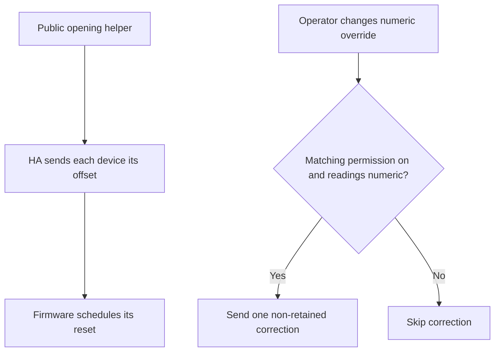

# Counter schedule versus manual correction

Warm-up uses the radio ON helper. The midnight action clears the nightly extension. Neither action publishes a count correction. The separate season-start setting has implications for season totals. Review the [implemented automations](../ha/automations/traffic_automations.md) before acting on a discrepancy.
