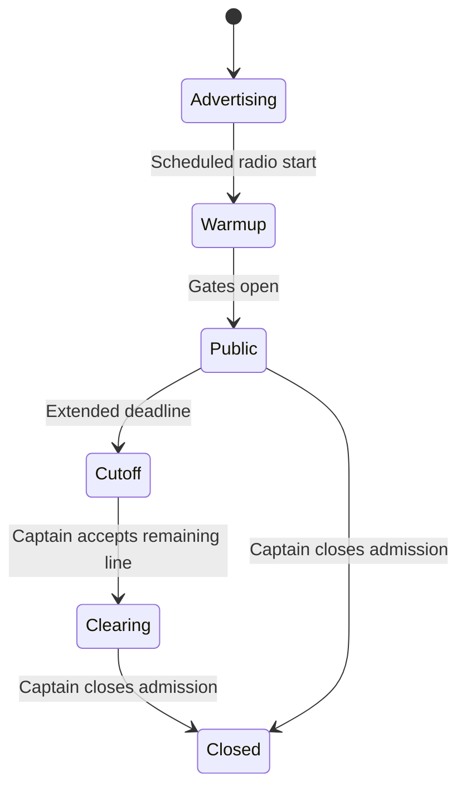

# Public schedule and admissions

Cutoff ends the scheduled public window. The sign bridge displays explicit closure wording only on the corresponding admission or weather command. Weather closure takes priority while master overlays are enabled. Master overlays off releases both signs to LOR. See [admission controls](../docs/signs.md) for override priority.
