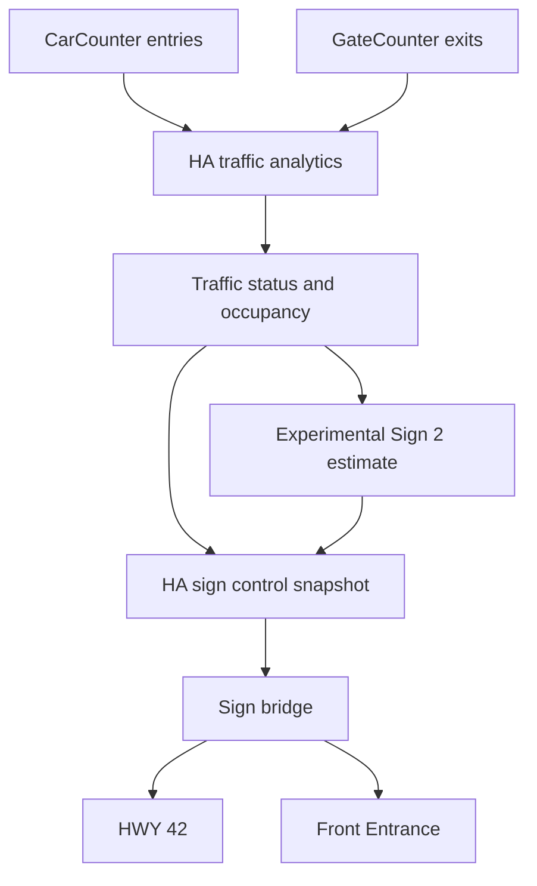

# How traffic measurements reach the signs

HWY 42 alone can display the Sign 2 wait estimate. The estimator requires valid inputs and an enabled model. The counters observe arrivals and departures at fixed points. They cannot tell the captain how far the line extends up the highway. Consult both camera views and the [estimator assumptions](../docs/signs.md).
